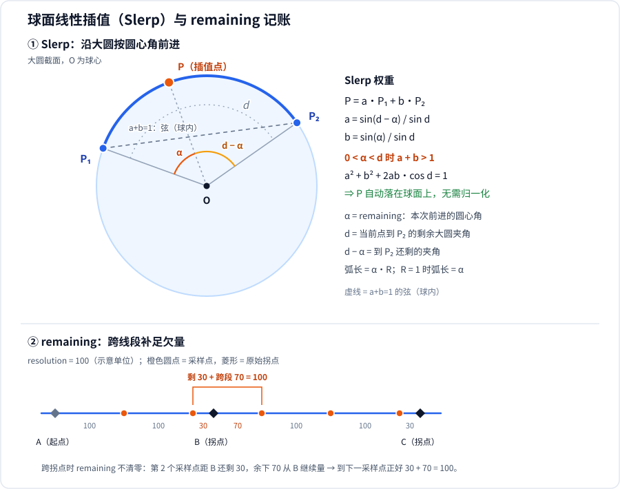

# ch01.resample_spherical_polyline
这段 C++ 代码是一个非常硬核且高频应用于自动驾驶与高精地图引擎（从包名和结构看，这正是大名鼎鼎的开源路由地图引擎 Valhalla 内部的核心算法）的函数。
它的核心功能是：对一条由经纬度坐标构成的“球面上折线（Polyline）”，按照指定的空间物理分辨率（例如每隔 10 米）进行等距离重新采样（Resample / 重插值）。
这完美呼应了你之前提问的 Haversine、球面余弦定律 以及 Valhalla 源码 的背景！下面为你逐行、逐模块进行硬核技术拆解：

## 1. 函数签名与参数释义

```cpp
template <class container_t>
container_t
resample_spherical_polyline(const container_t& polyline, double resolution, bool preserve)
```
• template <class container_t>：泛型设计。这里的 container_t 通常是 std::vector<std::pair<double, double>>，用来存储一连串的 (经度, 纬度) 坐标点。
• resolution：重采样的目标分辨率（单位：米）。比如传入 10.0，代表希望新生成的轨迹线上，点与点之间的球距恒定为 10 米。
• preserve：一个布尔控制开关。如果为 true，算法在等距插值的同时，会强制保留折线原本就有的转折拐点。

## 2. 算法核心步骤拆解


### 🚀 步骤一：边界检查与单位换算

```cpp
if (polyline.size() == 0) return {};
container_t resampled = {polyline.front()}; // 先把起点塞进结果集
resolution *= RAD_PER_METER;                // 【重点】把米制分辨率转为弧度制分辨率 ???
double remaining = resolution;              // 到下一个采样点还需要消耗多少弧度
auto last = resampled.back();
```

• 物理本质：在球面上，直接用“米”做距离运算非常昂贵。算法非常聪明，直接把传入的 10米 通过乘以 RAD_PER_METER（1/地球半径）转化为球面大圆弧度。后续的所有空间距离比较，全部在“弧度”层面上进行。

### 📐 步骤二：遍历每条线段，使用【球面余弦定律】计算长度

```cpp
for (auto p = std::next(polyline.cbegin()); p != polyline.cend(); ++p) {
    auto lon2 = p->first * -kRadPerDegD;  // 转换为弧度，注意由于地图投影，经度带了负号
    auto lat2 = p->second * kRadPerDegD;  // 转换为弧度
```

接下来，代码中有一段非常精彩的注释掉的源码：
```cpp
// double d = 2.0 * asin(sqrt(pow(sin(... // 这原本是 Haversine 公式
```
正如你之前看的文章所说，现代计算机 64 位浮点数精度极高，于是作者用**更简洁的一行【球面余弦定律】**替代了注释掉的 Haversine：
```cpp
    auto d = (last == *p) ? 0.0
                          : acos(sin(last.second * kRadPerDegD) * sin(lat2) +
                                 cos(last.second * kRadPerDegD) * cos(lat2) *
                                     cos(last.first * -kRadPerDegD - lon2));
```
• 功能：计算当前点 last 和下一个原始点 p 之间的球面弧度距离 d。如果计算结果发生数值越界产生 NaN（Not a Number），直接强制安全重置为 0.0。

### 📍 步骤三：利用【球面线性插值 (Slerp)】疯狂吐出等距点（核心循环）

当两点间距离 d 大于当前要求的步长 remaining 时，代表需要在线段中间插入新点：
```cpp
    while (d > remaining) {
      auto lon1 = last.first * -kRadPerDegD;
      auto lat1 = last.second * kRadPerDegD;
      
      auto sd = sin(d);

      // 下面用 Slerp 权重系数 a、b 混合三维坐标：a = sin(d - remaining) / sin(d)，b = sin(remaining) / sin(d)
      auto a = sin(d - remaining) / sd;
      auto acs1 = a * cos(lat1);
      auto b = sin(remaining) / sd;
      auto bcs2 = b * cos(lat2);
      
      auto x = acs1 * cos(lon1) + bcs2 * cos(lon2);
      auto y = acs1 * sin(lon1) + bcs2 * sin(lon2);
      auto z = a * sin(lat1) + b * sin(lat2);
      
      // 【反投影】将三维空间的 X, Y, Z 点还原为经纬度
      last.first = atan2(y, x) * -kDegPerRadD;
      last.second = atan2(z, sqrt(x * x + y * y)) * kDegPerRadD;
      resampled.push_back(last); // 将插值出的标准等距点塞入结果
      
      d -= remaining;            // 这条线段被消耗掉了 remaining 长的距离
      remaining = resolution;    // 刷新步长计数器，准备寻找下一个 10 米点
    }
```
• 数学内幕：这段代码在做 Slerp（球面线性插值）。它将经纬度转换为三维空间单位球上的 (X, Y, Z) 向量，用 Slerp 权重 a、b 混合出新点的 (X, Y, Z)，最后再用 atan2 逆向反投影成经纬度，从而确保生成的点绝对精准地贴在地球的圆弧表面上，而不是切线上。这里 a、b 与三角形的正弦定理没有关系：它们由“插值点必须是单位向量，且与起点 P₁ 的大圆夹角为 remaining”这一约束解出，即标准 Slerp 公式（推导见下文 ch02）。


### 🏁 步骤四：线段收尾与拐点保留

```cpp
    remaining -= d; // 跨过原始拐点，扣除这条线段最后剩下的一点尾巴距离
    last = *p;
    if (preserve) {
      resampled.push_back(last); // 如果指定了 preserve，强制把原始道路的拐点也塞进去
    }
  }
  return resampled;
}
```

### 💡 总结：这有什么实际用处？

在 Valhalla、Autoware 或大部分高精地图导航中，这个函数拥有统治级的地位。
因为用户手里的 GPS 轨迹、或者采集车录入的路网（折线），其点与点之间的距离是随机的（有时隔 2 米，有时直线上隔 100 米）。
为了进行后续的高精路网匹配（Map Matching）、车速动态规划、或者将道路切分成均等的网格（Tiling），必须通过这个函数，把任意畸形的折线，全部重采样洗成**“每隔 10 米必有一个点”的绝美规范化标准轨迹**。
 
==================================================

# ch02.球面线性插值 -doubaoAI

讲解下面代码中的球面线性插值（Slerp）
```cpp
template <class container_t>
container_t
resample_spherical_polyline(const container_t& polyline, double resolution, bool preserve) {
  if (polyline.size() == 0) {
    return {};
  };

  // for each point
  container_t resampled = {polyline.front()};
  resolution *= RAD_PER_METER;
  double remaining = resolution;
  auto last = resampled.back();
  for (auto p = std::next(polyline.cbegin()); p != polyline.cend(); ++p) {
    // radians
    auto lon2 = p->first * -kRadPerDegD;
    auto lat2 = p->second * kRadPerDegD;
    // how much do we have left on this segment from where we are (in great arc radians)
    // double d = 2.0 * asin(sqrt(pow(sin((resampled.back().second * kRadPerDegD - lat2) /
    // 2.0), 2.0) + cos(resampled.back().second * kRadPerDegD) * cos(lat2)
    // *pow(sin((resampled.back().first * -kRadPerDegD - lon2) / 2.0), 2.0)));
    auto d = (last == *p) ? 0.0
    : acos(sin(last.second * kRadPerDegD) * sin(lat2) +
            cos(last.second * kRadPerDegD) * cos(lat2) *
            cos(last.first * -kRadPerDegD - lon2));
    if (std::isnan(d)) {
      // set d to 0, do not skip in case we are preserving coordinates
      d = 0.0;
    }
 
    // keep placing points while we can fit them
    while (d > remaining) {
      // some precomputed stuff
      auto lon1 = last.first * -kRadPerDegD;
      auto lat1 = last.second * kRadPerDegD;
      
      auto sd = sin(d);
      
      auto a = sin(d - remaining) / sd;
      auto acs1 = a * cos(lat1);
      auto b = sin(remaining) / sd;
      auto bcs2 = b * cos(lat2);

      // find the interpolated point along the arc
      auto x = acs1 * cos(lon1) + bcs2 * cos(lon2);
      auto y = acs1 * sin(lon1) + bcs2 * sin(lon2);
      auto z = a * sin(lat1) + b * sin(lat2);

      last.first = atan2(y, x) * -kDegPerRadD;
      last.second = atan2(z, sqrt(x * x + y * y)) * kDegPerRadD;
      resampled.push_back(last);

      // we just consumed a bit
      d -= remaining;
      // we need another bit
      remaining = resolution;
    }
    // we're going to the next point so consume whatever's left
    remaining -= d;
    last = *p;
    if (preserve) {
      resampled.push_back(last);
    }
  }

  // TODO: do we want to let them know remaining?

  // hand it back
  return resampled;
}
```
## 一句话总览--doubaoAI

这不是**四元数Slerp**的应用（插值对象不是姿态，但公式同构），而是**球面上经纬度折线（大圆航线）的球面线性插值**，也就是**大圆插值（Great-circle interpolation）**，专门给GPS/经纬度轨迹重采样，固定弧长间隔打点，就是Valhalla里面路径采样的经典代码。
> 输入：一串经纬度点（polyline）；输出：沿着地球大圆、**弧长≈resolution** 的重采样点；preserve=true 会保留原始拐点。

先理清单位：
- `resolution`：米；`resolution *= RAD_PER_METER` → 把米转成**球面弧度**（表面弧长转圆心角：$s = R\theta \Rightarrow \theta = s/R$，其中 `RAD_PER_METER = 1 / 6378160.187`）
- 坐标存储：`(lon, lat)`，角度制；内部计算全部转弧度
- 经度带负号：`lon * -kRadPerDegD` 相当于把 y 轴翻转（镜像）。镜像不改变大圆距离和插值结果，反投影时再乘 `-kDegPerRadD` 复原；这只是 Valhalla 的坐标约定，不是算法的一部分

---
## 1. 核心公式：大圆上两点之间球面插值（就是这段）
```cpp
auto lon1 = last.first * -kRadPerDegD;
auto lat1 = last.second * kRadPerDegD;

auto sd = sin(d);
auto a = sin(d - remaining) / sd;
auto acs1 = a * cos(lat1);
auto b = sin(remaining) / sd;
auto bcs2 = b * cos(lat2);

// 球坐标转三维直角插值
auto x = acs1 * cos(lon1) + bcs2 * cos(lon2);
auto y = acs1 * sin(lon1) + bcs2 * sin(lon2);
auto z = a * sin(lat1) + b * sin(lat2);

// 转回经纬度
last.first = atan2(y, x) * -kDegPerRadD;
last.second = atan2(z, sqrt(x * x + y * y)) * kDegPerRadD;
```

### 数学来源：球面线性插值（大圆插值公式）
单位球面上两点 $\boldsymbol{P}_1,\boldsymbol{P}_2$，大圆夹角 $d$（弧度），从 $\boldsymbol{P}_1$ 往 $\boldsymbol{P}_2$ 前进圆心角 $\alpha$（这里就是 `remaining`），插值点 $\boldsymbol{P}$：
$$
\boldsymbol{P} = \frac{\sin(d-\alpha)}{\sin d}\boldsymbol{P}_1 + \frac{\sin\alpha}{\sin d}\boldsymbol{P}_2
= a\boldsymbol{P}_1 + b\boldsymbol{P}_2
$$
✅ 这就是**单位球面上三维向量的 Slerp**。对比四元数 Slerp：公式形式完全一样，只是插值对象从单位四元数换成**单位球上的 3D 位置向量**。
- $\boldsymbol{P}_1$：起点三维单位向量（由 lat1、lon1 算出）
- $\boldsymbol{P}_2$：终点三维单位向量（由 lat2、lon2 算出）
- $d$：两点之间的大圆夹角（由球面余弦公式算出）
- $\alpha = \text{remaining}$：本次要前进的圆心角

**为什么不需要归一化**：两个权重之和并不等于 1（$0<\alpha<d$ 时 $a+b>1$），但代入可验证
$$
a^2+b^2+2ab\cos d = 1.
$$
而 $\boldsymbol{P}_1\cdot\boldsymbol{P}_2=\cos d$，所以
$$
|\boldsymbol{P}|^2 = a^2+b^2+2ab\cos d = 1.
$$
也就是说，权重的“超额”恰好把点推到球面上；算出 x/y/z 后直接反投影即可，不必再除以模长。

把球坐标转直角坐标：
$$
\begin{cases}
x = \cos\phi \cos\lambda \\
y = \cos\phi \sin\lambda \\
z = \sin\phi
\end{cases}
$$
$\phi$=纬度，$\lambda$=经度（弧度）
代入上面加权求和，就是代码里 x/y/z 的计算。
算出 (x,y,z) 之后，再逆变换回经纬度：
$$
\lambda = \mathrm{atan2}(y,x),\quad \phi = \mathrm{atan2}\big(z,\sqrt{x^2+y^2}\big)
$$

> 重点区分：
> - 四元数 Slerp：在单位四元数构成的 $S^3$（四维空间中的单位球面）上插值**旋转姿态**
> - 本代码：在 $S^2$（三维空间中的单位球面）上插值**地球表面位置**（大圆航线）。公式同构，插值空间不同。

### 图：Slerp 的几何与 remaining 的记账



上半部分：$O$ 为球心，$\boldsymbol{P}_1,\boldsymbol{P}_2$ 为单位向量，$d$ 是二者夹角；插值点 $\boldsymbol{P}$ 沿大圆弧从 $\boldsymbol{P}_1$ 前进 $\alpha$。虚线弦对应 $a+b=1$ 的普通线性组合，落在球内；Slerp 的 $a+b>1$，落回球面。
下半部分：$d=230$、`resolution`$=100$ 时，`remaining` 如何跨过拐点 B 继续记账——在 B 处剩 30，下一段再走 70 才凑满 100。

---
## 2. 距离 d 怎么算（球面余弦公式）
```cpp
auto d = (last == *p) ? 0.0
                      : acos(sin(last.second * kRadPerDegD) * sin(lat2) +
                             cos(last.second * kRadPerDegD) * cos(lat2) *
                                 cos(last.first * -kRadPerDegD - lon2));
if (std::isnan(d)) d = 0.0;
```
标准**球面余弦定理**，得到 `last` 到 `p` 的大圆圆心角（弧度）：
$$
\cos d = \sin\phi_1\sin\phi_2 + \cos\phi_1\cos\phi_2\cos(\lambda_1-\lambda_2)
$$

这里的关键是 `last` 不是“上一个输入点”那么固定：它初值是上一段结束时的点，段内每插一个采样点就被改写成新点，并 `resampled.push_back(last)`。`d` 在每段开头用当时的 `last` 算一次（本段总夹角），`while` 内靠 `d -= remaining` 递减；所以 `while` 里的 `d` 始终表示**从当前位置到本段终点还剩多少弧度**，`p` 才是这一段固定的终点。

- 完全重合时三元表达式直接取 0，省一次 `acos`。
- 被注释掉的是 Haversine 公式：小角度下数值更稳，但这里为少几次三角函数用了余弦公式。
- 余弦公式在 $d\to0$ 时 `acos` 的相对精度差（$\cos d\approx1$，舍入会让参数略超出 $[-1,1]$ 而得到 NaN），所以用 `std::isnan(d)` 兜底置 0，而不是跳过该点。

---
## 3. 整个循环逻辑（滑动剩余弧长 remaining）
目标：相邻采样点的**大圆弧长尽量等于 resolution**；跨过原始顶点时把欠量带过去，保证跨段后仍然等距。

1. 初始：`resampled` 先放第一个点；`remaining = resolution`，表示从当前位置再走这么多弧度就该打下一个点
2. 遍历原 polyline 每一段 `last → p`：
   - 用球面余弦公式算出 `last` 到 `p` 的这段大圆夹角 `d`（本段总长）
   - `while (d > remaining)`：本段剩下的弧还够再放一个采样点
     - 用 Slerp 从 `last` 沿大圆前进 `remaining`，得到新点
     - 新点加入结果，并成为新的 `last`
     - `d -= remaining`：从“当前位置到 p”的夹角里扣掉刚走的一段
     - `remaining = resolution`：下一个点重新按整段算
   - 退出 while：本段剩下的 `d` 不足一个采样间隔
     - `remaining -= d`：把这个欠量留到下一段——下一段先走 `remaining` 再打点
   - `preserve=true`：不管间隔，强制把原始拐点 `p` 也加入输出（需要保留原始顶点的场景靠它）
3. 效果：段内严格等弧长，跨段时把欠量补上；`preserve=true` 时额外保留原始顶点

举个直观例子（`resolution = 100`，用米说明；换成弧度只是同乘 `RAD_PER_METER`，比例不变）：
A——B 大圆距离 230，B——C 再 300。
- 初始 `remaining = 100`
- A→B：`d = 230 > 100`，在距 A 100 处打第 1 个点；`d` 变 130，`remaining` 回 100
- 仍 `130 > 100`：再打第 2 个点（距 A 200）；`d` 变 30，`remaining` 回 100
- `30 < 100`，退出 while；`remaining = 100 - 30 = 70`
- 到达 B：第 2 个点到 B 还剩 30，`remaining = 70` 表示下一段还要再走 70
- B→C：先走 70 打第 3 个点（距 B 70，也就是距第 2 个点 30 + 70 = 100），此后每 100 一个点

---
## 4. 关键坑 & 工程细节（Valhalla 这个实现的特点）

1. **是大圆插值，不是平面线性插值**
   直接对 lat/lon 做线性插值（在等距圆柱投影上画直线）会偏离大圆，纬度越高偏差越大；这里沿地球球面最短路径（大圆）插值，导航路网、轨迹采样必须用这个。
2. **权重和不为 1，但结果在球面上**
   $a+b\neq1$，不要误以为漏了归一化；恒等式 $a^2+b^2+2ab\cos d=1$ 保证 $|\boldsymbol{P}|=1$。
3. 数值稳定性
   - 极小距离时 `acos` 的参数可能因舍入略超 $[-1,1]$，产生 NaN；代码捕获后置 0。
   - 没有像标准 Slerp 那样在小角度退化成 Nlerp 的分支，这是它的取舍。
4. 坐标系符号：经度乘 `-kRadPerDegD`
   是 Valhalla 内部对经度方向/坐标系的约定，相当于镜像；不改变大圆距离和插值结果，反投影时再乘 `-kDegPerRadD` 复原。
5. preserve 参数
   - `preserve=true`：原始路径拐点全部保留，采样点是【等间隔点 + 原始拐点】
   - `preserve=false`（默认）：只输出等间隔点，原始拐点会被丢弃（可能破坏路网拓扑）
   - 需要保住原始顶点的场景（如 `src/midgard/tiles.cc` 中把长测地线段重采样成折线）会显式传 `true`；此时拐点被额外插入，原来一个 100 的间隔会被切成两段（如图中 B 两侧的 30 和 70），严格等弧长在拐点处不再成立

## 5. 和你之前问的 Slerp 对比
|项目|四元数 Slerp（姿态）|本代码球面插值（位置）|
|---|---|---|
|插值对象|单位四元数|单位球上的 3D 位置向量|
|球面|$S^3$：四维空间中的单位球面|$S^2$：三维空间中的单位球面（地球表面）|
|公式形式|$\frac{\sin((1-t)\theta)}{\sin\theta}q_0+\frac{\sin(t\theta)}{\sin\theta}q_1$|$\frac{\sin(d-\alpha)}{\sin d}\boldsymbol{P}_1+\frac{\sin\alpha}{\sin d}\boldsymbol{P}_2$|
|用途|IMU/pose 姿态平滑|GPS 轨迹、路网 polyline 重采样|

> 总结：**公式同构，都是球面线性插值，只是插值空间不同**，这就是为什么 Valhalla 这个函数叫 `resample_spherical_polyline`。

## 6. 补充：什么时候会用到这个？
Valhalla 的 route polyline、shape 采样、高程注入、轨迹可视化，都靠这个函数把稀疏的路网点重采样成等间距点，方便后续计算航向、曲率、高程、ADASIS 报文。

本文的几何示意与 `remaining` 记账图见同目录下的 [`slerp-diagram.svg`](slerp-diagram.svg)：上图说明 Slerp 的权重如何把点落在球面上，下图说明跨拐点时欠量如何带入下一段。

==================================================

# ch03.RAD_PER_METER = 1.0 / 6378160.187

## 0. 它是什么、写在哪

`valhalla/midgard/pointll.h:14-16`：

```cpp
namespace {
  // 弧度(rad)定义：在一个圆里，**弧长等于半径的那段圆弧，对应的圆心角就是 1 弧度**。
  // 1r弧长  <对应> 1弧度圆心角
  // 6378160.187对应旧 GRS67 参考椭球的赤道半径
constexpr double RAD_PER_METER = 1.0 / 6378160.187;// = 1rad / 1地球半径
} // namespace
```

一句话：**1 米在地球大圆上对应的圆心角（弧度）**，即地球半径的倒数。单位是 rad/m，不是 m/rad。
`constexpr` 表示编译期求值，数值为
 
================================================

# ch04.球面线性插值的完整数学推导过程
球面线性插值（Spherical Linear Interpolation，简称 Slerp）用于在球面上两个向量之间进行平滑过渡，常用于计算机图形学和机器人学中的四元数旋转插值。与普通线性插值（Lerp）相比，Slerp 能保持恒定的角速度。
以下是球面线性插值的完整数学推导过程。

1. 问题定义与几何模型

假设有两个单位向量 \(\mathbf{p}_{\mathbf{0}}\) 和 \(\mathbf{p}_{\mathbf{1}}\)（即 \(\Vert{}\mathbf{p_0}\Vert{} = \Vert{}\mathbf{p_1}\Vert{} = 1\)），它们之间的夹角为 \(\theta \)。我们希望找到一个夹角随参数 \(t \in [0, 1]\) 线性变化的插值向量 \(\mathbf{p}(t)\)：
• 当 \(t = 0\) 时，\(\mathbf{p}(0) = \mathbf{p_0}\)
• 当 \(t = 1\) 时，\(\mathbf{p}(1) = \mathbf{p_1}\)
• \(\mathbf{p}(t)\) 与 \(\mathbf{p}_{\mathbf{0}}\) 的夹角为 \(t\theta\)，与 \(\mathbf{p}_{\mathbf{1}}\) 的夹角为 \((1-t)\theta\)。
由于 \(\mathbf{p}(t)\) 位于 \(\mathbf{p}_{\mathbf{0}}\) 和 \(\mathbf{p}_{\mathbf{1}}\) 决定的二维平面上，我们可以将 \(\mathbf{p}(t)\) 表示为这两个向量的线性组合：
\(\mathbf{p}(t)=a(t)\mathbf{p}_{\mathbf{0}}+b(t)\mathbf{p}_{\mathbf{1}}\)
我们的目标就是求出系数 \(a(t)\) 和 \(b(t)\)。

2. 利用几何投影推导

为了利用向量的点积性质，我们在 \(\mathbf{p}_{\mathbf{0}}\) 和 \(\mathbf{p}_{\mathbf{1}}\) 构成的平面内建立方程。
根据点积的定义，单位向量之间的点积等于它们夹角的余弦值：
1. \(\mathbf{p_0} \cdot \mathbf{p_1} = \cos\theta\)
2. \(\mathbf{p_0} \cdot \mathbf{p}(t) = \cos(t\theta)\)
3. \(\mathbf{p_1} \cdot \mathbf{p}(t) = \cos((1-t)\theta)\)
现在，我们将 \(\mathbf{p}(t) = a\mathbf{p_0} + b\mathbf{p_1}\) 分别与 \(\mathbf{p}_{\mathbf{0}}\) 和 \(\mathbf{p}_{\mathbf{1}}\) 作点积：

方程一：与 \(\mathbf{p}_{\mathbf{0}}\) 作点积

\(\mathbf{p}_{\mathbf{0}}\cdot \mathbf{p}(t)=\mathbf{p}_{\mathbf{0}}\cdot (a\mathbf{p}_{\mathbf{0}}+b\mathbf{p}_{\mathbf{1}})\)
\(\cos (t\theta )=a(\mathbf{p}_{\mathbf{0}}\cdot \mathbf{p}_{\mathbf{0}})+b(\mathbf{p}_{\mathbf{0}}\cdot \mathbf{p}_{\mathbf{1}})\)
因为 \(\mathbf{p}_{\mathbf{0}}\) 是单位向量，\(\mathbf{p_0} \cdot \mathbf{p_0} = 1\)，所以：
\(\cos (t\theta )=a+b\cos \theta \quad \text{---\ (式1)}\)

方程二：与 \(\mathbf{p}_{\mathbf{1}}\) 作点积

\(\mathbf{p}_{\mathbf{1}}\cdot \mathbf{p}(t)=\mathbf{p}_{\mathbf{1}}\cdot (a\mathbf{p}_{\mathbf{0}}+b\mathbf{p}_{\mathbf{1}})\)
\(\cos ((1-t)\theta )=a(\mathbf{p}_{\mathbf{1}}\cdot \mathbf{p}_{\mathbf{0}})+b(\mathbf{p}_{\mathbf{1}}\cdot \mathbf{p}_{\mathbf{1}})\)
同理：
\(\cos ((1-t)\theta )=a\cos \theta +b\quad \text{---\ (式2)}\)

3. 求解线性方程组

我们得到了一个关于 \(a\) 和 \(b\) 的二元一次方程组：
1. \(a + b\cos\theta = \cos(t\theta)\)
2. \(a\cos\theta + b = \cos((1-t)\theta)\)
由（式1）可得：
\(a=\cos (t\theta )-b\cos \theta \)
将 \(a\) 代入（式2）：
\((\cos (t\theta )-b\cos \theta )\cos \theta +b=\cos ((1-t)\theta )\)
\(\cos (t\theta )\cos \theta -b\cos ^{2}\theta +b=\cos ((1-t)\theta )\)
\(b(1-\cos ^{2}\theta )=\cos ((1-t)\theta )-\cos (t\theta )\cos \theta \)
利用三角恒等式 \(1 - \cos^2\theta = \sin^2\theta\)，以及和差化积/两角差的余弦公式 \(\cos((1-t)\theta) = \cos\theta\cos(t\theta) + \sin\theta\sin(t\theta)\)，代入上式右边：
\(b\sin ^{2}\theta =\big(\cos \theta \cos (t\theta )+\sin \theta \sin (t\theta )\big)-\cos (t\theta )\cos \theta \)
\(b\sin ^{2}\theta =\sin \theta \sin (t\theta )\)
两边约去 \(\sin\theta\)（假设 \(\theta \neq 0, \pi\)）：
\(b=\frac{\sin (t\theta )}{\sin \theta }\)
同理，将 \(b\) 的值代入 \(a = \cos(t\theta) - b\cos\theta\) 中：
\(a=\cos (t\theta )-\frac{\sin (t\theta )\cos \theta }{\sin \theta }\)
\(a=\frac{\cos (t\theta )\sin \theta -\sin (t\theta )\cos \theta }{\sin \theta }\)
利用正弦两角差公式 \(\sin(\alpha - \beta) = \sin\alpha\cos\beta - \cos\alpha\sin\beta\)：
\(a=\frac{\sin (\theta -t\theta )}{\sin \theta }=\frac{\sin ((1-t)\theta )}{\sin \theta }\)

4. 最终 Slerp 公式

将求得的 \(a(t)\) 和 \(b(t)\) 代回原线性组合式，即可得到经典的 Slerp 公式：
\(\mathbf{p}(t)=\frac{\sin ((1-t)\theta )}{\sin \theta }\mathbf{p}_{\mathbf{0}}+\frac{\sin (t\theta )}{\sin \theta }\mathbf{p}_{\mathbf{1}}\)
其中 \(\theta = \arccos(\mathbf{p_0} \cdot \mathbf{p_1})\)。

5. 边界与特殊情况处理

在实际工程实现（如代码编写）中，需要注意两个关键边界：
• \(\theta \to 0\)（两向量几近重合）：
此时 \(\sin\theta \to 0\)，会导致除以零错误。此时应退化为普通的线性插值（Lerp）：
\(\mathbf{p}(t)\approx (1-t)\mathbf{p}_{\mathbf{0}}+t\mathbf{p}_{\mathbf{1}}\)
• \(\theta \to \pi\)（两向量方向相反）：
此时两条向量共线但反向，它们之间存在无数条等长的最短大圆路径，插值方向不唯一（旋转轴不确定）。在四元数插值中，通常会通过取反其中一个四元数来选择较短的路径。
请问你是在编写游戏引擎/图形学代码（例如需要处理四元数取反的最短路径问题），还是在进行纯数学/物理推导？如果有需要，我可以为你提供 C++/Python 的具体代码实现。解。
